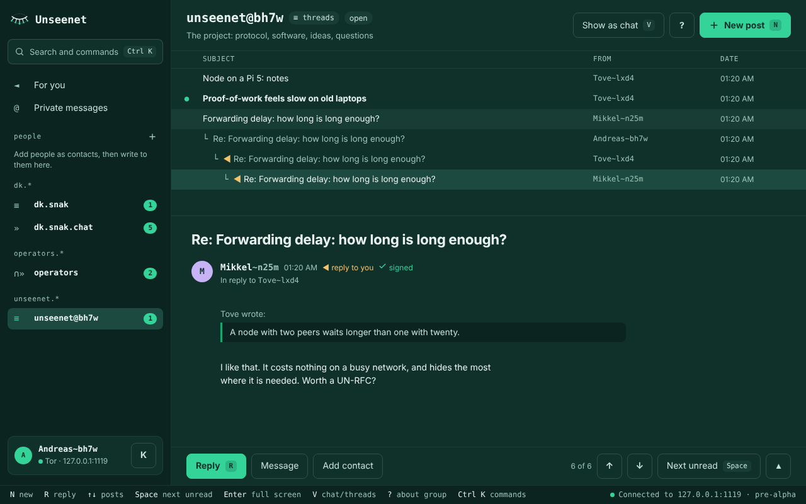
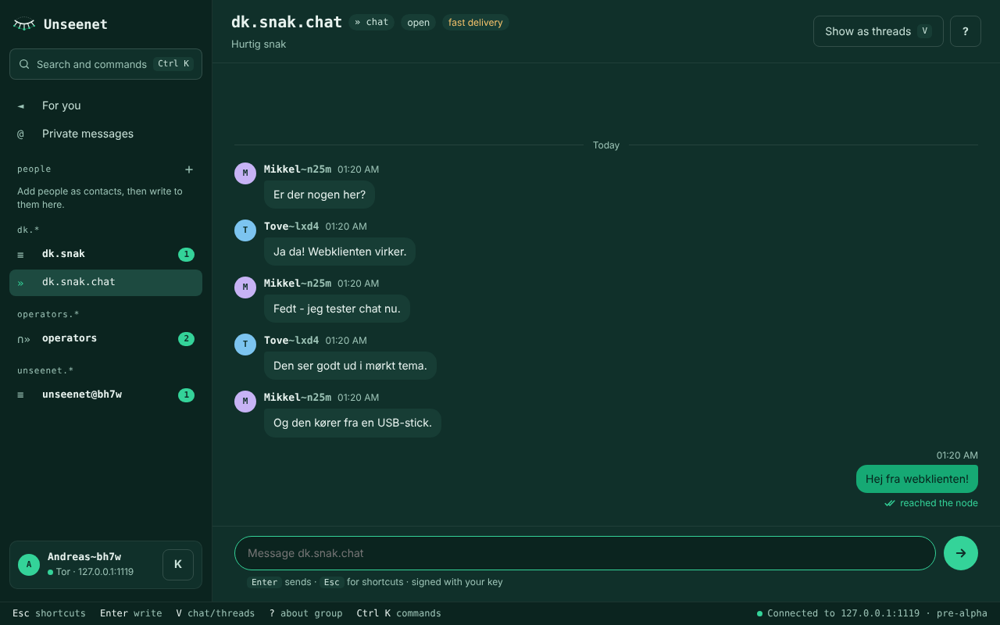

# The graphical client

The graphical client is Unseenet in a window: your groups on the left,
threads you click through, chat that looks like chat, your private posts and
contacts, and the groups you run. It uses the same groups, keys and vault as
the [terminal client](client.md), and lives in its own repository,
[unseenet/unseenet-gui](https://github.com/unseenet/unseenet-gui).

!!! warning "Pre-alpha"
    Neither the graphical client nor the Unseenet core has had a security review.
    Play with it and pick it apart; do not rely on it to protect anyone yet.



A discussion is not a chat, and the graphical client keeps them apart.
Discussion groups work like a newsreader: the posts as a tree, one post at a
time below it, ++up++ ++down++ through the thread, ++space++ to the next
unread, and ++r++ to answer in a compose window with the post quoted and your
signature below. Chat groups are chats. The group's owner decides which a
group is, and ++v++ shows it the other way. Everything else is in the command
palette, ++ctrl+p++.

## Three ways to run it

Get the newest release from
[GitHub](https://github.com/unseenet/unseenet-gui/releases/latest). Every
build is self-tested before it is published.

### Portable (Linux, macOS, Windows) { #portable }

Unzip and start, from a USB stick or a folder: nothing is installed. Tor is
included, and everything stays in `data/` beside the programs.
`unseenet-gui-…-usb.zip` has every platform; or take only yours:

- **Windows:** `Unseenet Graphical.exe` opens an app window (no console).
- **macOS:** `Start Unseenet Graphical.command` opens an app window.
- **Linux:** `sh start-graphical-linux.sh` opens Chromium, Chrome, Edge or
  Brave without tabs if you have one, else your browser.

### Bootable (USB, SSD etc.) { #bootable }

Write `unseenet-gui-…-x86_64.img.xz` to a USB stick (for example with
Raspberry Pi Imager or balenaEtcher), boot from it, and the client starts
full screen and runs from memory, touching nothing on the computer's disks,
as with the terminal client's [bootable image](bootable.md). The first screen
sets up Wi-Fi and the keyboard. It needs 4 GB of memory. In the boot menu,
*safe graphics* helps if the screen stays black, and *text only* starts the
terminal client instead. The same stick also starts the portable client on a
running computer, with the same `data/`.

### In your browser

On a phone, a tablet or any computer, with nothing to install: open a web
entrance, for example [entrance.unseenet.net](https://entrance.unseenet.net/).
It is the same client, running in the browser, and the less hidden way in.
Read [In your browser](web.md) first.

The graphical client uses the same `Unseenet/` folder and `data/` as the
terminal client's [portable build](portable.md), so the two can share a stick
and a vault. Do not run both on the same vault at the same time.

## First start

1. **Choose a passphrase.** It encrypts your vault. There is no way to
   recover it if you forget it.
2. **Choose a display name.** This is just a label. Your real identity is a
   key pair that is created for you.
3. **Choose a node.** The client suggests one of the project's nodes at
   random, so not everyone starts on the same one, and keeps the others as
   backups. Choose *Another node* for an address you were given.

You start in the project's groups - `unseenet`, `unseenet.announce`,
`unseenet.help`, `unseenet.chat` and `unseenet.test`, and the demo site and
feed `unseenet.demo.site` and `unseenet.demo.feed` - so there is something to
read. The
first connection takes 10-30 seconds while Tor builds its circuits. Your
first post waits a few minutes more, once, while your new key
[ripens](spec/un-rfc-0025.md); the client shows how far it is. Stuck? Ask in
`unseenet.help` - see [Getting help](https://unseenet.org/help/).

## What it can do



- Read and write: threads and chats (closed groups decrypted), posts, replies
  and chat lines in Markdown with emoji, *For you* (replies and mentions),
  `#group` links, editing your own posts, your signature.
- Feeds and sites (from 0.5): *Timeline* with the feeds you follow, **My
  feed** and **My site**, creating a group as a feed or a site, pages with an
  index, and a person's feed and site from their profile.
- Pictures and files (from 0.5): in posts, chat lines and private posts, as
  the group allows; profile pictures.
- Pins, reactions and tables in Markdown (from 0.5); a ⋯ menu on every post
  and chat line to edit, withdraw, pin or copy its `unseenet:` address.
- Private chats and posts with anyone, by key; contacts as an address book;
  private profiles shared with one person or a closed group.
- People: names (`@you`), profiles (an author's name opens theirs; *Your
  profile* writes yours), ignoring people, hiding bots.
- Groups you run: create open, moderated, channel or closed groups, invite
  to closed ones, moderators and posters, bans, approving posts, reporting.
- What you may not write, it says before you write: in a channel's comments,
  under a ban, in a closed group you are not in.
- Your vault: change its passphrase (copies elsewhere keep the old one).
- A light and a dark theme, and phones and other narrow screens. On the
  bootable image also the network, Wi-Fi, the keyboard, restart and shut down.

Not yet - use the [terminal client](client.md): Tor bridges and several
identities. **Updating** a stick or portable folder of the graphical client
is not there yet either, because its builds are not signed yet: download the
new release for now.

## How it works

The graphical client draws its window with web technology, but the portable
and the bootable one are not a website. They run on your own computer,
nothing is hosted anywhere, and on Linux the window it opens in your browser
only talks to the program on your own machine. (In a browser the same program
runs inside the browser instead; see [In your browser](web.md).)

```
 window ──HTTP/WebSocket──▶ unseenet core's local API ──▶ Session ──Tor──▶ nodes
 (127.0.0.1 only)           (UN-RFC 0046)                 vault, keys, postage
```

The window talks to the core's [local client API](spec/un-rfc-0046.md), the
same `Session` the terminal client uses: the same encrypted vault, the same
Tor and the same nodes. The window only draws what you see: **keys, signing,
encryption and postage never leave the core**, and the passphrase is sent
once, to unlock.

The local server guards itself against other programs and web pages on the
same computer: it listens on 127.0.0.1 only, every start makes a random token
that every request must carry, and a strict Content-Security-Policy keeps the
page from loading anything from outside. What people wrote reaches the window
as the core's safe render tree, never as HTML, and links in posts are not
opened by themselves, because following one would leave Tor. The
[README](https://github.com/unseenet/unseenet-gui#security) has the details.

## With pip

You need Python 3.11 or newer and Tor installed (the portable and bootable
builds bring their own), as for the [terminal client](client.md):

```sh
pip install unseenet-gui
unseenet-gui            # opens your browser
unseenet-gui --window   # in its own window: pip install "unseenet-gui[window]"
```

`--window` uses the system's web view in private mode, so nothing ends up in
your browser's history. The graphical client is released on its own, with
the minor version of the core it works with; see its
[changelog](https://github.com/unseenet/unseenet-gui/blob/main/CHANGELOG.md).
