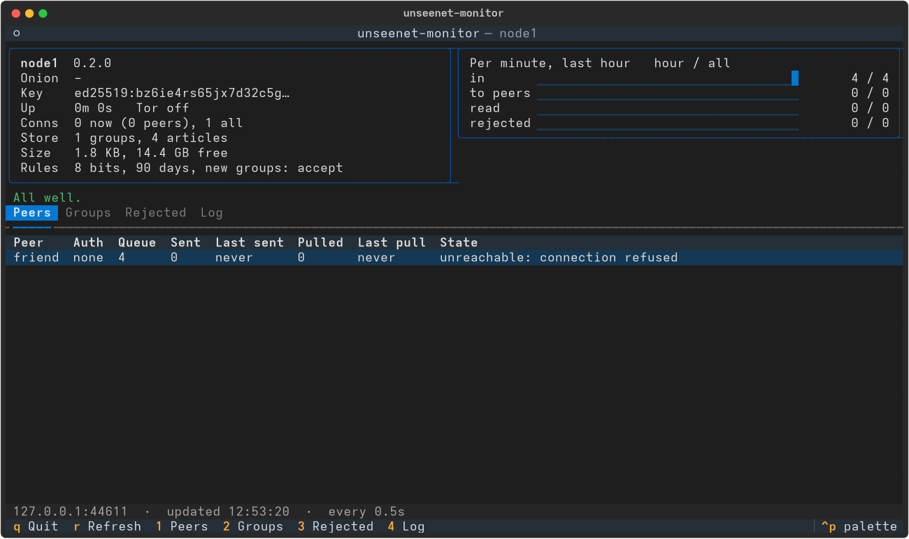

# Monitor

`unseenet-monitor` shows how your node is doing, at a glance: traffic in the
last hour, your peers and whether they answer, storage, Tor, warnings and
the node's last log lines.



It is a program of its own. It only **reads** from the node and cannot change
anything; the node runs on whether the monitor is open or not.

## Start it

On a node set up with `install-node.sh`, just run:

```bash
unseenet-monitor
```

That starts it as the node's user, who owns the stats socket. Elsewhere, run
it as the node's user yourself:

```bash
sudo -u unseenet /home/unseenet/unseenet/.venv/bin/unseenet-monitor
```

It finds the node in the usual places (`node-data/monitor.sock` in the
current directory, in your home, or in `/home/unseenet`). Otherwise name the
node's stats socket:

```bash
unseenet-monitor --node /home/unseenet/node-data/monitor.sock
```

Over SSH it works the same way: `ssh -t mynode sudo -u unseenet .../unseenet-monitor`.

Several nodes on one machine? Give `--node` once for each, and switch with
++n++ and ++p++.

The monitor needs Textual, like the client: `pip install "unseenet[monitor]"`
(`install-node.sh` installs it).

| Key | |
|-----|---|
| ++1++ ... ++4++ | Peers, Groups, Rejected, Log |
| ++n++ / ++p++ | Next / previous node |
| ++r++ | Refresh now (it refreshes every 2 seconds) |
| ++q++ | Quit |

## What it shows

- **The node**: name, version, onion address, node key, uptime, Tor, open
  connections, groups and articles, storage and free disk, its policy.
- **Per minute, last hour**: articles accepted (from clients, peers and
  catching up), sent to peers, read by clients, rejected - and the totals
  since the node started.
- **Warnings**: Tor not running or still starting, a peer that has not
  answered for a day, a long queue for a peer, little disk space.
- **Peers**: how each is authenticated, articles waiting and sent, the last
  catch-up (UN-RFC 0017) and the last error.
- **Groups**: the groups with the most articles.
- **Rejected**: why articles were refused (postage, signature, size, unknown
  group, duplicate, ...) - a sudden rise can mean someone is testing your node.
- **Log**: the node's last log lines.

## The stats interface

The node serves the numbers on a **Unix socket in its data directory**,
`monitor.sock`, readable only by the node's user (and its group). It is never
reachable over Tor, and the node refuses to serve it on anything but this
computer.

```bash
unseenet-node --data node-data --monitor node-data/monitor.sock   # the default
unseenet-node --data node-data --monitor 127.0.0.1:1120           # Windows, tests
unseenet-node --data node-data --monitor off
```

It answers one request per line with one line of JSON: `stats` gives a
snapshot, `log 100` the last log lines. That makes it easy to use from other
tools as well:

```bash
printf 'stats\n' | sudo -u unseenet nc -U /home/unseenet/node-data/monitor.sock | jq .traffic
```

The format is described at the top of `src/unseenet/node/stats.py` (`"v": 1`).

!!! note "Nothing about readers"
    The numbers are counters only. The node does not record who reads what -
    not even which groups or articles are read, only how many articles were
    served in total - as the node's logging policy (UN-RFC 0011) promises.
